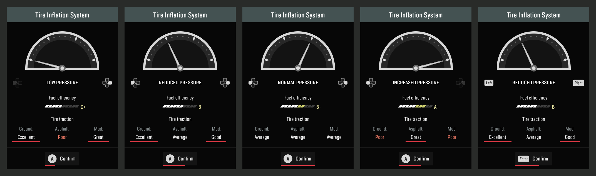

# Next Gen Tire Inflation

Formerly the SnowRunner Tire Inflation System; its files keep the name `TirePressure`. Tire pressure you change while driving, as in Expeditions: A MudRunner Game.

The truck you drive gets four pressure modes: Low, Reduced, Normal and Increased. Let air out and the tires flatten, grip harder on dirt, sand, rock and in mud, and lose grip on asphalt. The truck also uses more fuel and steers slower. Increased is the road mode: more grip on asphalt, less everywhere else, less fuel. Soft tires driven too fast take damage until they go flat, and a flat tire has no grip. Cold air and cold rubber change how the tires grip, a change of pressure waits for the truck to stand still, and hard mode sets everything to the most realistic numbers. You pick the mode on Expeditions' panel, drawn in SnowRunner's font, with the pad or a key. You hear the air go out and in, and every few fillings the compressor.



## What you need

- SnowRunner for Windows. The mod was made on the Steam version (the game build of 22 July 2026). At every start it looks for the places it needs in the game's code. Where it does not find the ones it cannot do without, on another build of the game, it writes that into its log and does nothing. The Epic Games Store and Game Pass versions have not been tested.
- ReShade 6.8.0, which comes in the zip as `dxgi.dll` and `ReShade.ini`, for compatibility with overlays such as RivaTuner, Discord, Nvidia and Steam. It shows nothing of its own; Home opens its window. A ReShade already in the game works as it is (any ReShade from 6.8.0 on with add-on support). Without ReShade the game can crash with the RivaTuner or Discord overlay or with multiple monitors, and the mod says so at the start.

- The full manual, with every number and formula, as a PDF: [Next Gen Tire Inflation Manual](https://github.com/andizla/snowrunner-tire-inflation-system/blob/main/docs/Next_Gen_Tire_Inflation_Manual.pdf), also [in Russian](https://github.com/andizla/snowrunner-tire-inflation-system/blob/main/docs/Next_Gen_Tire_Inflation_Manual_ru.pdf).

## Install

1. Close the game.
2. Copy the files from the zip into the game's `Sources\Bin` folder, next to `SnowRunner.exe`: `version.dll`, `TirePressure.asi`, `dxgi.dll` and `ReShade.ini`.
3. Start the game. F2 opens the NEXT GEN menu, and its Tire Inflation tab has the mod's settings. The key (F3) or the pad opens the panel.

Already using ReShade? Choose Skip for `dxgi.dll` and `ReShade.ini` when Windows asks, and yours stays. If the mod then says the ReShade in the game takes no add-ons, copy in `dxgi.dll` alone. Coming from 1.2 with the ReShade it brought: this zip's `dxgi.dll` can go over it.

`version.dll` is a small loader: it loads every file in that folder whose name ends in `.asi`. If you already use an ASI loader (other `.asi` mods work in that folder), copy only `TirePressure.asi` and leave your loader as it is. If another mod's `version.dll` is there and it is not an ASI loader, rename that one to `version_chain.dll` first, and this loader passes everything on to it.

To update, copy the new files over the old ones (keep your `ReShade.ini` if you changed it). Keep only one `.asi` file of this mod in the folder: a second copy under another name stands down and says so in the log.

## Use

With a pad (any pad Windows sees as an Xbox pad):

- LB + d-pad down opens the panel.
- LB + d-pad left or right lowers or raises the pressure. With the panel closed, it opens the panel one step lower or higher.
- While the panel is open the d-pad works without LB, A confirms and B closes the panel unchanged.
- The triggers are shaped: at the default of 2, half the trigger gives a quarter of the throttle or brake and the full pull stays full, so a light pull is gentle. The tab's pad throttle and brake curves set it (see Settings); at 1 the game reads them as they are.

With the keyboard, F3 opens the panel and steps the pressure down, from Low round to the highest mode. There is no key to confirm with: leave the choice alone.

A choice left alone confirms itself after 5 seconds. The tires then take 6 seconds to deflate from Normal to Low, less for a smaller step, and up to 9 from Low to Increased (the pressure moves on one scale: Low is 45% of Normal's, Reduced 65%, Increased 125%). The change only goes on while the truck stands still: a choice made while driving waits, and a hint at the top left says so (`StandStill`, see Realism). With the beep switched on (it is off unless you turn it on), the mod beeps as the change begins: once for Normal, twice for Reduced, three times for Low, one high beep for Increased.

Each truck keeps its own mode. The mode is saved by the truck kind's name in `TirePressure.trucks.ini` and comes back the moment you drive that truck again, without a sound or a wait, across map loads and game starts. A truck not driven since 1.3.1 starts at Normal. Two trucks of one kind share it. `PerTruck=0` in the ini (or the tab's checkbox) gives the old way: one mode for every truck, Normal at each game start.

## Sounds

- Deflating plays the air being let out. It gets weaker as the tires empty and stops with a puff.
- Filling plays the air going in.
- The compressor does not run at every filling. The air comes out of a tank, and the compressor fills the tank again once it has fallen far enough: at every second filling from Low to Normal, at every fourth of a single step. It then runs for about 17 seconds, also after the filling is done, and lets its own air go as it stops.

The two air sounds are recordings of a real tire, made for this mod. The compressor is made by the mod's own code. The air it lets go as it stops is a sound of SnowRunner itself, which the mod reads out of the game's sound file while the game runs. You hear all of them while you drive a truck and the game's window is in front.

## The modes

Multipliers against the tire's own values:

| | Low | Reduced | Increased |
|---|---|---|---|
| Grip on dirt | x3.5 | x3.0 | x0.9 |
| Grip on gravel | x2.75 | x2.4 | x0.95 |
| Grip on sand | x4.0 | x3.4 | x0.85 |
| Grip on rock | x3.5 | x3.0 | x0.9 |
| Grip on asphalt | x0.85 | x0.95 | x1.3 |
| Grip in mud | x1.3 | x1.15 | x0.85 |
| Tire radius | up to 10 cm less | up to 6 cm less | unchanged |
| Fuel use while moving | x1.5 | x1.25 | x0.85 |
| Steering speed | x0.7 | x0.85 | x1.1 |

Each wheel takes the grip for the ground under it, so a truck with two wheels on a gravel road and two in sand grips differently left and right. Each grip multiplier stops at 10, as in Expeditions, and so does the ground grip the game is given.

The game draws the flattened tires itself, and only so flat. Where 10 cm would put the tread under the ground, both steps shrink by the same share: a scout on 94 cm tires gets 6.7 and 4 cm. In the cold no step goes past that room. A tire that comes soft, as some modded tires do, sinks into the ground under the truck's weight, and the game draws a tire by where it touches the ground: the mod measures how far each wheel's contact sits inside its round shape and takes that off the room first, so such a tire is flattened less. A vanilla tire sinks next to nothing. The tab's truck section shows the first wheel's sink and room. A flattened tire rolls a little less far per turn, as a real one does: that scout loses about 5% of its speed at Low and 3% at Reduced.

## Tire damage

Soft tires wear when the truck is too fast for them:

| | Low | Reduced |
|---|---|---|
| Wear starts above | 20 km/h | 35 km/h |
| Most wear from | 30 km/h | 45 km/h |
| Damage per wheel | 4 to 8 | 2 to 6 |
| Every | 7 seconds | 10 seconds |

A SnowRunner wheel takes about 50 damage. While the truck is too fast a warning shows at the top left with the most worn tire's damage in percent, and with the beep switched on a low beep marks each hit. A worn out tire goes flat and has no grip at all until it is repaired. This is the game's own wheel damage: the game's wheel icon turns red for a flat tire, the damage stays in the save, and it is repaired like any other damage. The numbers start from those of Expeditions' off-road tires, with twice the damage at lower speeds, as SnowRunner's trucks are slower off the road.

## Realism

Four settings in the tab and the ini. The first two are on by default.

- Pressure changes only while the truck stands still (`StandStill`). A choice made while driving waits, and a change under way pauses, until the truck stands. A hint at the top left says so.
- The tires feel the outside temperature (`Temperature`). The air in them follows the gas law, with Normal taken as 35 psi: at 20 below, Normal holds 83% of its pressure and runs softer, flatter and with more grip on soft ground, and Low is as soft as the tires go; at 35 above, Normal holds 110%. Cold rubber grips less, most on asphalt and rock: a fifth less at 20 below. Warm rubber grips a little more on asphalt and rock. Above Normal's pressure the tires slide toward Increased's numbers, as over-inflated tires do, also with Increased switched off. In the heat soft tires wear from lower speeds, in the cold from higher ones. The modes' numbers are for 15 C. The outside temperature is `AmbientC` (the tab's slider, 15 to begin with), or comes by map and hour from a gauge mod by the same author while that runs: it publishes the temperature in a block of shared memory, whose layout `src\outside.h` has. The tab shows the temperature in force and the pressure the tires hold.
- Hard mode (`HardMode`). The numbers and options nearest to real tires, all at once: a change takes half a minute and only while the truck stands, the tires feel the outside temperature, soft tires wear, flattened tires roll like real ones, vanilla balance is on, no asphalt floor, no base grip, and the modes get these numbers:

| | Low | Reduced | Increased |
|---|---|---|---|
| Grip on dirt | x1.6 | x1.3 | x0.92 |
| Grip on gravel | x1.3 | x1.15 | x0.95 |
| Grip on sand | x1.9 | x1.45 | x0.85 |
| Grip on rock | x1.6 | x1.3 | x0.92 |
| Grip on asphalt | x0.8 | x0.9 | x0.97 |
| Grip in mud | x1.35 | x1.18 | x0.9 |
| Tire radius | up to 5 cm less | up to 2.5 cm less | unchanged |
| Fuel use while moving | x1.25 | x1.12 | x0.96 |
| Steering speed | x0.8 | x0.9 | x1.05 |
| Wear starts above | 30 km/h | 50 km/h | |
| Most wear from | 55 km/h | 75 km/h | |
| Damage per wheel | 2 to 10 | 1 to 6 | |
| Every | 8 seconds | 10 seconds | |

Airing a tire down to half its pressure lengthens its contact patch by about half, which is that much more grip on sand and soft ground and a little less on hard ground; over-inflating does the reverse and gains nothing on asphalt. A soft tire's sidewalls flex and heat at speed, so its wear starts higher up than the defaults but ends a tire faster. While hard mode is on, every other setting but the outside temperature, the controls, the panel and the sounds is greyed out in the tab, and `TirePressure.ini` keeps your own numbers for when it is off.

- Globalhacker insanity mode (`InsaneMode`), built from the own settings of the player Globalhacker. Harder than real tires, for players who want the game to fight back: Low grips x2 on dirt and x0.4 on asphalt, Reduced x1.5 and x0.45; soft tires wear from 15 km/h in Low (the most from 20, 8 to 16 every 2 seconds) and from 20 km/h in Reduced (the most from 25, 4 to 12 every 2 seconds), so they are worn out within seconds a little too fast; a change takes 25 seconds and only while the truck stands; flattened tires lose the speed the smaller wheel loses; no Increased mode; and the vanilla balance at 2. Hard mode and the insanity mode exclude each other and grey out the same settings.

## Settings

The NEXT GEN menu has a Tire Inflation tab. It shows the truck's tires, the ground under the first wheel and the speed, and it edits every setting while you play. F2 opens and closes the menu; another key is set by clicking the key's name at the menu's top right and pressing it, or in `NextGen.ini` next to the exe (`[Menu]`, `Key=` a virtual key code), which the Next Gen mods share. With Next Gen Gameplay installed, its Gameplay tab is in the same window. While the menu is open the game gets no mouse and no keys. With Next Gen Graphics installed the menu also has a Graphics tab. It switches Graphics' effects while you play. Its F keys are off then; KeysWithMenu=1 in SnowRunnerShadows.ini keeps them.

- Every number in the two tables of the modes, and tire damage on or off.
- Hard mode, changes only while standing still, whether each truck keeps its own pressure, the outside temperature and whether the tires feel it.
- Whether flattened tires roll like real ones. On by default. Off, the truck loses about three times as much speed.
- Vanilla balance: tires that grip better than every vanilla tire on ground, asphalt and mud at once (some modded trucks have them) come down just far enough that some vanilla tire, of any kind, matches or beats them in all three. Vanilla tires stay as they are. Off by default. Its strength goes from 0 to 2: 1 brings such a tire to the vanilla tire, above 1 below it (at 2 the tire's ratio to the vanilla tire counts twice, so three times the vanilla grip ends at a third of it), for modded trucks that should be harder to drive than vanilla ones.
- Base grip for ground, asphalt and mud: scales every mode, Normal too.
- Asphalt floor: every tire grips at least this much on paved ground. Off by default.
- The key, the pad buttons, the pad's throttle and brake curves (`PadThrottleCurve`, `PadBrakeCurve`: a trigger's share to this power while you drive, 2 by default, where half the trigger gives a quarter and the full pull stays full; 1 is as it is), the panel's size, the time until a choice confirms itself, how long a pressure change takes, the sound volume (0 turns the sounds off), and the beep.

Changes count at once and are saved to `TirePressure.ini` in the same folder. The file can be edited by hand too: the game writes it with the defaults and a short guide on its first start. Each truck's mode goes into `TirePressure.trucks.ini` in the same folder, one section per truck kind with a line such as `Mode=Low`. It can be edited by hand as well.

Four keys are in the ini alone. `AirOutSound`, `AirInSound`, `CompressorSound` and `CompressorStopSound` each put another sound in place of the mod's own: the name of a WAV file in `Sources\Bin`, or of a sample in the game's `shared_sound.pak` such as `[sound]\actors\actor_lamp_generator_loop.pcm`. `none` leaves that sound out. The first three play round and round while they last. A WAV file with a loop marked in it plays up to the loop once, then goes round in the loop, and plays what follows the loop as the sound stops.

## Remove

Delete `TirePressure.asi`, `TirePressure.ini`, `TirePressure.trucks.ini` and `TirePressure.log` from `Sources\Bin`. `version.dll` and `AsiLoader.log` go too when no other `.asi` mod is left (Next Gen Gameplay loads through them), and `NextGen.ini` when no other Next Gen mod is left. If you renamed another mod's `version.dll` to `version_chain.dll`, rename it back. ReShade from the zip goes the same way when nothing else uses it: `dxgi.dll`, `ReShade.ini` and `ReShade.log`.

## Notes

- The mod changes values in the running game's memory. It changes no game file.
- Trailers keep their tires as they are.
- The pad's panel buttons are taken from the game only while you drive a truck. In menus they are the game's.
- Co-op has not been tested.
- On a PC whose Windows proxy settings are on automatic detection the first frame can come late by half a minute: ReShade checks for its own update at the start and waits on that lookup.
- Without a sound device the sounds stay off and everything else works.
- After a game update the mod keeps working when the game's code around its places is unchanged. When it is not, the mod does nothing and says so in its log, until a version for the new game is out.
- The mod publishes its state for other mods in a block of shared memory, `Local\SnowRunnerTirePressure.State.<process id>`: the mode, the pressure and its target, the outside temperature in force, the most worn tire and a few flags. `src\tire_state.h` has the layout. A gauge cluster can show the pressure level from it.
- If something does not work, `TirePressure.log` in `Sources\Bin` says what the mod found and did. `GrabDumps.bat` from the zip, run in `Sources\Bin` with the game closed, gathers the logs, the ini files and the crash dump into one zip beside itself, for a report.
- Support, discussion and ideas: the author's channel on EnthusiastRunner's Discord, https://discord.com/invite/MssDb2Pvcj, or an issue on GitHub for a bug report.

## Planned

- Game Pass: the fix in 1.3.0 counts as confirmed once a player's log on that build shows it.
- PS5 controllers: the mod reads XInput pads only today.
- Clearer names for the settings.

## Build

Windows with Visual Studio 2022 (C++ desktop tools).

```
build.bat
test.bat
```

`build.bat` makes `out\version.dll` and `out\TirePressure.asi`. `test.bat` runs the offline tests: the loader on a test `.asi`, the loader with a copy of itself as its chain file, the loader behind another ASI loader that had the `.asi` first, and the mod's own checks (every setting through the ini and back, the flattening and gear numbers, the pressure scale, the outside temperature and hard mode, the readers of the sound files, the compressor's tank), and the overlay's way to the game's swap chains: two stand-in Next Gen mods in a program that makes its swap chains through its imports as the game does, both drawing once for each Present and each Present1, with DirectX's own method tables left as they were and the DirectInput reads in place; a stand-in for the Steam overlay's hook, under the mods in DirectX's factory table, must see only DirectX's own Present in every new swap chain (the code before the fix shows it two), and the two mods' slot writes on one read-only page at once must all land. `out\test\probe_test.exe sound` plays the sounds through the default sound device as the mod does in the game. `test\build_preview.bat` builds a program that draws the panel, the warning and the settings tab into PNG files without the game and checks the pad binding window. It needs the Dear ImGui sources, see the file.

A few places the mod needs lie elsewhere in every build of the game's exe. It finds them itself (`src\build_find.h`). `out\test\probe_test.exe find <exe>` runs the same search on an exe in a file and prints what it found and what it did not. Steam's exe on disk will not do for that, as its code is only readable in the running game. With `SR_IMAGE` set to a copy of the exe's image from a running game, `test.bat` checks the search against the numbers of the builds it knows: the Steam build it was made on (exe stamp 6a607c05) and the game's update of 20 October 2026 (6ab52f5d).

## How it works

A thread in the game process reads and writes the game's own values 20 times a second, through `ReadProcessMemory` and `WriteProcessMemory` on its own process, so an object the game frees under it gives an error and no crash. No game code is patched. Three of the game's pointers are pointed at the mod: its two pointers to `XInputGetState` and one entry of its import table.

At its start the mod looks through the exe for the places it needs: two of the game's classes by their names, the global that leads to the driven truck, the game's damage update and the truck update's call into Windows. It also checks six spots of game code that use the same positions inside the game's objects as the mod does. Without the classes, the global or one of the six, the mod stands down and has changed nothing. Without the damage update or the truck update's call it runs, and deals tire damage from its own thread.

- Grip: the asphalt and mud grip of each wheel, and the truck's list of ground grip values, one per wheel. The game marks each wheel every frame with the kind of ground under it (gravel, sand, hard, paved), and the mod picks the factor from that. A worn out tire gets 0 in all three until the game repairs it.
- Flattening: the radius of the wheel's collision cylinder, held to what the game's wheel shader can draw flat.
- Speed: in the game the wheel is its collision cylinder, so a flattened tire would lose about three times the speed a real one does, whose belt keeps its length. The mod raises the truck's gear speeds by the difference.
- Fuel and steering: the truck's fuel consumption values and its steering speed.
- The pressure: one number, the tires' pressure as a share of Normal's, moves between the modes at the set pace, and every factor is read off it between the two nearest modes. The outside temperature moves that number by the gas law before the factors are read, and scales the grip for the rubber. The temperature is read from another mod's block of shared memory (`src\outside.h`) while that is there and fresh, else from `AmbientC`.
- Damage: the game's damage data for each wheel. The game's truck update asks Windows once a frame which window is in front. That import table entry leads through the mod, which deals the damage at that moment, on the game's own thread, and then runs the game's damage update. The update makes a worn out tire flat, mends a repaired one and sums the truck's damage. On a build of the game where the mod does not find that call, it deals the damage from its own thread and makes the worn out tire flat itself; the game's damage display then follows at the next damage the game deals.
- Pad: the game keeps pointers to `XInputGetState` (two in the Steam build). The mod points them at a filter that hides the panel's buttons from the game while the panel uses them.
- Panel and menu: drawn by Next Gen's own overlay, the same code as Next Gen Gameplay's. The mod hooks the game's Present, the call that puts each frame on the screen, and draws with Dear ImGui on the game's own device just before the frame goes out. It takes the game's imports of `CreateDXGIFactory1` and `D3D11CreateDevice` and gives each swap chain the game makes a method table of its own with the mod's Present (and Present1), which calls on to what the table held. DirectX's own method tables stay as they are: the Steam overlay hooks whatever they hold each time a swap chain is made, and with the mod's hook in them the two called each other until the game ran out of stack. Where ReShade is installed, ReShade hands the mod each swap chain the game makes at its presents instead. The release brings ReShade 6.8.0 without its start banner, with a `ReShade.ini` that loads no effects and keeps Home for ReShade's own window (`tools/reshade_nobanner.py` makes that `dxgi.dll` from ReShade's own; `tools/ReShade.ini` is the ini): on a tester's PC with RivaTuner, Discord's overlay and two monitors the game crashed without ReShade and not with it. Where ReShade is missing or does not take the mod as an add-on, the start says so in the log, in a line at the top for 15 seconds and in the NEXT GEN menu. While the menu is open, the game's reads of the mouse and the keys (through user32 and DirectInput) get nothing new, and releases still reach it. The text is baked from the game's own font files at run time.
- Sound: a thread of its own plays through XAudio2, the library the game brings and uses itself, and only holds a sound device while a sound plays. The two recordings are in the `.asi` (`assets`, `src\sounds.rc`): each has its start, a steady part that goes round for as long as the change lasts, and its stop. The compressor is made by code: 47 knocks a second that ring in a housing, with the air it draws and the motor's hum. The air it lets go as it stops comes out of the game's `shared_sound.pak`, a zip in which the samples lie as WAV files. A tank decides when the compressor runs: a filling takes air out of it, and below a mark the compressor runs until it is full.

## Licence and credits

GNU General Public License v3.0 (GPL-3.0-only), see `LICENSE`.

The tire inflation system, its panel and its numbers are from Expeditions: A MudRunner Game by Saber Interactive. The panel and the menu are drawn with Dear ImGui by Omar Cornut, and their text is baked with stb_truetype by Sean Barrett. ReShade by Patrick Mours (crosire), which the zip brings without its start banner, hands the mod the game's swap chains through its add-on API. Their notices are in `THIRD_PARTY_NOTICES.md`. The asphalt floor follows an idea by Naybour. The sounds of air let out of a tire and of air going into one (`assets`) were recorded for this mod and are under its licence.

A big thank you to the testers who gave their time to the early builds: Milos_Mk6, Globalhacker and Zenosxy. Your runs, logs, ideas and patience shaped this release, and it would not be what it is without you.

SnowRunner and Expeditions are games by Saber Interactive. This project is not affiliated with Saber Interactive or Focus Entertainment and contains no game files.
